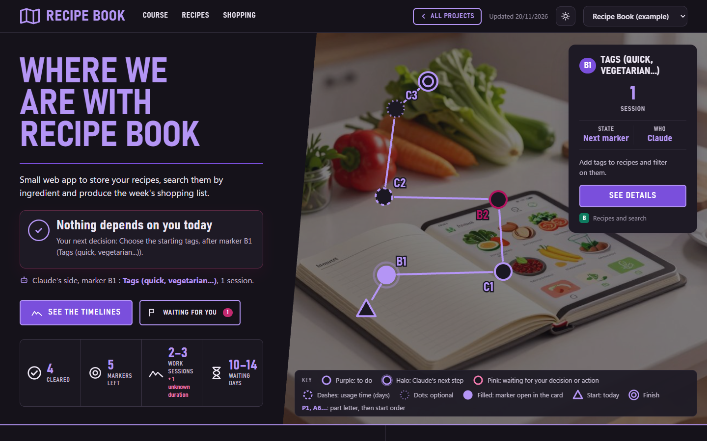
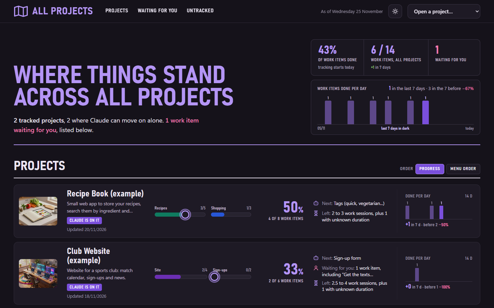

# Project tracker for Claude

Two offline HTML pages that show where your projects built with Claude stand. Claude keeps them up to date itself:
you only look.



- **`index.html`, one project's page.** What is finished, what remains, what waits for your decision, Claude's next
  step, and a timeline per part where the length of each stretch shows its estimated duration.
- **`overview.html`, all projects on one page.** Percentage of work items done, status, next step, what is waiting for
  you, and the pace of items completed per day.



The pages open by double-click, with no server, no installation and no account, and send nothing over the Internet.
Light or dark mode through the moon / sun button at the top.

## How it works

The pages contain no data. Each project has a small `suivi.js` file at its root, which **Claude fills in and updates
at every step completed**, following the `project-tracker` skill included here. The skill also tells Claude never to
invent a state, a date or a figure: what it cannot find in the project, it asks you.

## Install

1. Download the repository ([ZIP](https://github.com/jceou-labs/claude-project-tracker/archive/refs/heads/main.zip) or
   `git clone`) and put the folder somewhere it will stay, for example `~/project-tracker`.
2. Open Claude Code in that folder and say:
   > Install the project tracker in this folder by following INSTALL.md.
3. Claude installs the `project-tracker` skill in `~/.claude/skills/` (it asks first) and opens the pages with two
   example projects.

## Track one of your projects

Open a Claude Code session in the project and say:

> Add this project to the tracking page.

Claude reads the project (plan, notes, Git history), creates `suivi.js`, registers the project in `projects/index.js`,
offers you a background image, and gives you the link. From then on, every session that finishes a work item updates
the page. The two examples can go as soon as your first real project is in.

A project you do not want to detail can still appear at the bottom of the overview: one line in
`projects/untracked.js` (Claude can write it).

## Backgrounds

Each project's card can have its own background image. Seven come with the kit, in `backgrounds/`: `kitchen`,
`workshop`, `study`, `home-lab`, `mobile-app`, `game-studio` and `data-ai`.

To use your own, copy a landscape `.jpg` (about 1600 px wide) into `backgrounds/`, then set `fond` on the project's
line in `projects/index.js`:

```js
{ id: "rocket", nom: "Rocket", fichier: "C:/Users/you/rocket/suivi.js", fond: "backgrounds/rocket.jpg" }
```

Without `fond`, the page draws a terrain instead. Claude offers this choice when it adds a project; you can also ask it
later ("use backgrounds/study.jpg for this project").

## Files

| File | What it is |
|---|---|
| `index.html`, `overview.html` | The two pages. |
| `theme.css`, `theme.js` | Colours and light / dark mode, shared by both pages. |
| `projects/index.js` | The projects in the menu: id, name, path to their `suivi.js`, background. |
| `projects/_template.js` | Blank data file, every field explained. |
| `projects/example.js`, `projects/example-2.js` | Made-up projects for the demonstration. |
| `projects/untracked.js` | Projects without a detailed page, listed on the overview. |
| `backgrounds/` | Background images for the project cards. |
| `check.ps1` | Windows: checks a project's data file in headless Edge and prints "ok" or the problems. |
| `skill/project-tracker/SKILL.md` | The instructions Claude follows to create and update the data. |
| `INSTALL.md` | The installation steps, written for Claude. |

## Good to know

- Tested on Windows with Edge and Chrome. The pages are plain HTML and should work in any recent browser; `check.ps1`
  is Windows only, and elsewhere the page itself shows problems in a banner at the top.
- The headings use Bahnschrift, a Windows font; other systems get a close fallback.
- The data files keep French field names and values (`parties`, `chantiers`, `etat: "fait"`...), and dates are
  written dd/mm. `projects/_template.js` explains each of them in English.
- The overview's pace counts finished work items that carry a date. The "since" differences under the figures come
  from a snapshot the browser keeps at each opening, so they appear from the second day.

## See also

- [claude-context](https://github.com/jceou-labs/claude-context): a context gauge above the Claude Code prompt, with
  Compact and Handoff note buttons.
- [claude-workflow-skills](https://github.com/jceou-labs/claude-workflow-skills): nine skills that keep long Claude
  Code work on track across sessions and projects.
- [claude-local-images](https://github.com/jceou-labs/claude-local-images): lets Claude generate images on your own
  graphics card, free and private. It made the background images of this kit.

## License

MIT. The background images were generated for this kit and are under the same license.
